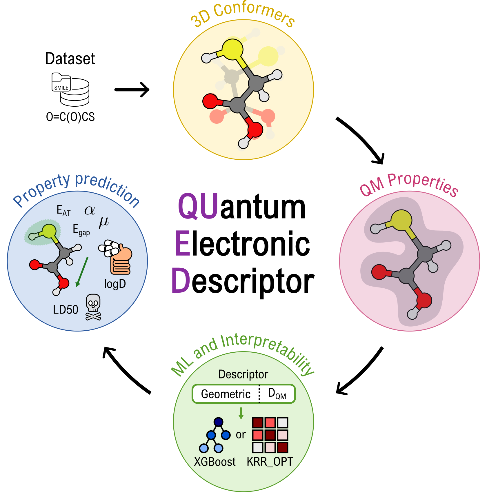

[](https://chemrxiv.org/engage/chemrxiv/article-details/68c61dd73e708a7649eb1250)

# QUantum Electronic Descriptors (QUED)

## About
QUED is a machine learning framework for molecular property prediction that integrates both structural and electronic information, enabling efficient modeling of the properties of drug-like molecules. It derives a **quantum-mechanical descriptor** from molecular and atomic properties using the semi-empirical DFTB method and combines it with inexpensive two-body and three-body **geometric descriptors** (BoB and SLATM) to create comprehensive molecular representations for training regression models (e.g., Kernel Ridge Regression, XGBoost). We validated QUED on the prediction of physicochemical properties (QM7-X dataset) and the ADMET endpoints: toxicity (TDCommons-LD50 dataset) and lipophilicity (MoleculeNet-Lipophilicity benchmark).

<p align="center">
  
</p>

## QM datasets
The structural and property data of drug-like molecules in TDCommons-LD50 and MoleculeNet-Lipophilicity datasets can be downloaded from the ZENODO repository https://zenodo.org/records/17106019.

The dataset generation, training, and evaluation of the ML models were performed on CPUs with an x86_64 architecture.

## Installation
All Python dependencies are managed with [pixi](https://pixi.sh) through
`pixi.toml` (what to install) and `pixi.lock` (the exact, reproducible versions).

`pixi.toml` defines two environments that share every package except PyTorch:

| Environment | Platforms | PyTorch | Use it for |
|---|---|---|---|
| `default` | macOS (Apple Silicon, macOS ≥ 14), Linux | 2.13, CPU build (MPS on Mac) | laptop work, CPU jobs |
| `gpu` | Linux only (glibc ≥ 2.34, CUDA 13 driver) | 2.13, CUDA 13.0 build | GPU jobs on a cluster |

Main packages: numpy, scipy, pandas, matplotlib, h5py, scikit-learn, rdkit, ase,
crest + xtb, dscribe, optuna, shap, xgboost 2.1.4, py3Dmol, mace-torch,
e3nn 0.5.1, chemprop, skala, ipykernel.

### 1. Install pixi
```bash
curl -fsSL https://pixi.sh/install.sh | sh
```
This installs a single binary into `~/.pixi/bin` (no admin rights needed). Open a
new terminal afterwards and check with `pixi --version`.

### 2. Local installation (Mac / laptop)
From the repository root:
```bash
pixi install
```
This creates the CPU environment in `.pixi/envs/default` (the `gpu` environment is
Linux-only and is not installed on a Mac). Use it with:
```bash
pixi shell                      # activate (like `conda activate`); `exit` to leave
pixi run python script.py       # or run a single command without activating
```

**Jupyter notebooks in VS Code:** choose **Select Kernel → Python Environments** and
pick the environment whose path ends in `.pixi/envs/default`. If it is not listed,
run **Python: Clear Cache and Reload Window**, or choose **Enter interpreter path**
and give `/path/to/QUED/.pixi/envs/default/bin/python`.

### 3. HPC cluster installation
**Keep pixi files out of `$HOME` (once per cluster).** Home directories are small and
limit the number of files. Put the package cache and the environments on your
workspace / project filesystem (not on a scratch area that gets purged):
```bash
echo 'export PIXI_CACHE_DIR=/path/to/workspace/.cache/pixi' >> ~/.bashrc
source ~/.bashrc
pixi config set --global detached-environments /path/to/workspace/.pixi-envs
```
Keep both on the same filesystem so pixi can hard-link instead of copying.
`pixi info` shows where everything ends up.

**Install the environments** on a login node (compute nodes usually have no
internet access), from the repository root:
```bash
pixi install              # CPU environment
pixi install -e gpu       # GPU environment
```
If the login node has no GPU and pixi complains that CUDA is not available, run
`CONDA_OVERRIDE_CUDA=13.0 pixi install -e gpu`.

**Slurm jobs:**
```bash
#!/bin/bash
#SBATCH --job-name=qued-cpu
#SBATCH --cpus-per-task=8
#SBATCH --time=02:00:00

cd /path/to/QUED
eval "$(pixi shell-hook)"            # CPU environment
python script.py
```
```bash
#!/bin/bash
#SBATCH --job-name=qued-gpu
#SBATCH --gres=gpu:1
#SBATCH --time=02:00:00

cd /path/to/QUED
eval "$(pixi shell-hook -e gpu)"     # GPU environment
python train.py
```
You can also run `pixi run -e gpu python train.py` without activating.

### 4. Using the environment from any folder
pixi looks for `pixi.toml` in the current folder and its parents. From anywhere
else, point to it explicitly, or define aliases in `~/.bashrc` / `~/.zshrc`:
```bash
pixi run --manifest-path /path/to/QUED/pixi.toml python script.py

alias qued='eval "$(pixi shell-hook --manifest-path /path/to/QUED/pixi.toml)"'
alias qued-gpu='eval "$(pixi shell-hook -e gpu --manifest-path /path/to/QUED/pixi.toml)"'
```

### 5. Tools not managed by pixi
- [`dftb+`](https://dftbplus-recipes.readthedocs.io/en/latest/introduction.html)
  (version 24.1) is needed to compute DFTB properties. It **cannot share an
  environment with xtb 6.7.1** (used by crest), so DFTB+ and the scripts that call
  it are kept as separate files and run in their own environment, e.g.:
  ```bash
  conda create -n qued-dftb -c conda-forge python=3.11 'dftbplus=24.1=mpi_openmpi_*' dftbplus-tools dftbplus-python ase
  conda activate qued-dftb
  ```
  In that environment, replace the `dftb.py` file of the `ase` package with the one
  provided in this repository (it includes reference values for Hubbard derivatives):
  ```bash
  cp dftb.py "$(python -c 'import ase.calculators.dftb as m; print(m.__file__)')"
  ```
  The DFTB+ outputs are then read by the `qued` modules in the pixi environment.
- [`KRR-OPT`](https://github.com/arkochem/krr-opt.git) for training KRR models.

### 6. Notes and troubleshooting
- **e3nn 0.5.1 override.** `mace-torch` pins an older e3nn, but 0.5.1 is needed to
  use skala and MACE together. `pixi.toml` overrides the pin
  (`[pypi-options.dependency-overrides]`); this works in practice.
- **PyTorch comes from conda-forge, not PyPI.** The PyPI wheel bundles its own
  OpenMP library and crashes on import (`OMP: Error #15`) next to the conda-forge
  packages. Do not `pip install torch` into these environments.
- **Rebuild an environment from scratch:** `pixi clean -e default` (or `-e gpu`),
  then `pixi install` again.
- **Update packages:** edit `pixi.toml` (or run `pixi update`), check that everything
  still works, and commit the new `pixi.lock`.

## Command Line Interface
The `qued` directory includes scripts that can be used as standalone executables. 

### Convert SMILES to 3D coordinates
From a CSV file with SMILES (and optionally target property values), it creates xyz files for each molecule in the dataset with initial 3D atomic coordinates.
```bash
python3 smile2geom.py -i dataset.csv -x 'smiles' -y 'target' -o 'conformers'
```

### Perform conformational search
From the initial 3D atomic coordinates of a given molecule (stored in an xyz file), conformers are generated via CREST. The output file `crest_conformers.xyz` contains the atomic coordinates of all the generated conformers.
```bash
# conformational search for small molecules
crest mol.xyz -gfn2 -gbsa h2o -mrest 10 -rthr 0.1 -ewin 12.0
# conformational search for medium-size molecules
crest mol.xyz -gfn2 -gbsa h2o -mrest 5 -rthr 0.1 -ewin 12.0 -quick
# conformational search for large molecules
crest mol.xyz -gfn2 -gbsa h2o -mrest 5 -rthr 0.1 -ewin 12.0 -mquick -norotmd
```

### Calculate QM properties
Elements covered by the 3ob parameters set: Br-C-Ca-Cl-F-H-I-K-Mg-N-Na-O-P-S-Zn. The parameters can be downloaded from [dft.org](https://dftb.org/parameters/download.html#). Add the following environment variables to your shell (e.g., in .bashrc, .zshrc, or your job script), replacing the placeholder paths with your own installation paths:
```bash
# Path to your DFTB+ executable (MPI-enabled if available)
export DFTB_COMMAND='mpiexec -n 1 /path/to/dftb+/qued/bin/dftb+'
# Path to the DFTB+ parameter set (e.g., 3ob-3-1 directory)
export DFTB_PREFIX='/path/to/slater-koster-files/3ob-3-1/'
# Set number of OpenMP threads (must be 1 if running under MPI)
export OMP_NUM_THREADS=1
```

Takes up to 10 conformers with the lowest xTB energy after the generation and creates `Geom-n[i]-c[j].npz` files, which store the calculated QM properties. 
```bash
python3 electronic.py -i crest_conformers.xyz -n 10 -o qmprops
```

### Dataset generation
The script `smile2database.py` allows the user to input a SMILE or a csv file with SMILEs to directly generate a HDF5 file with the DFTB-calculated properties of up to `n` conformers obtained by CREST conformational search (when `n=0`, it extracts all conformers), and optionally include a target property present in the csv file:
```bash
python3 smile2database.py -i dataset.csv -x 'SMILE' -y <optional target> -o <output directory> -n 0
```
By default, this program performs conformational search considering this configuration: `-gfn2 -gbsa h2o -mrest 10 -rthr 0.1 -ewin 12.0`. In case the user decides to use a different setting, `line 84` of this script should be modified with the desired arguments.


### Validate trained ML regression models
The hyperparameters of trained ML models are included in pickle files in the `models` directory (`krr_models.xz` and `xgb_models.xz`). The user can choose between XGBoost and KRR models trained for physicochemical properties, toxicity and lipophilicity prediction (we include only the best models per dataset and per regression model). The script `dataset2pred` allows the user to use these trained models to 1) Validate the results reported in the paper. 2) Perform inference in a new dataset of molecules. The flag `-v` serves for the objective (1), in this case, the user must include the employed training dataset (in HDF5 format), which can also be found in the `models` directory (`training_sets.xz`). 

In the case of XGBoost, the trained pipeline is already included in the pickle file.
```bash
# validation
python3 dataset2pred.py -v -i /path/to/training_dataset.h5 -m /path/to/model.pkl
# inference
python3 dataset2pred.py -i /path/to/new_dataset.h5 -m /path/to/model.pkl
```

It is not convenient to record the KRR estimator in a pickle file (it would result in a GB-sized file), so instead, we saved all necessary parameters of the KRR model in the pickle file and re-train (or re-fit) the KRR model with the employed training dataset (in HDF5 format). Such training datasets are found in the `models` directory (`training_sets.xz`). 
```bash
# validation
python3 dataset2pred.py -v -i /path/to/training_dataset.h5 -m /path/to/model.pkl -t /path/to/training_dataset.h5
# inference
python3 dataset2pred.py -i /path/to/new_dataset.h5 -m /path/to/model.pkl -t /path/to/training_dataset.h5
```

The user can add the flag `-sh` to the arguments of this script to perform a SHAP analysis with the trained XGBoost model, considering the input dataset (independent of the mode used).
```bash
python3 dataset2pred.py -v -i /path/to/training_dataset.h5 -m /path/to/model.pkl -sh
```

### Notebook
The `qued.ipynb` notebook illustrates how to perform conformational search and QM calculations starting from a SMILE. It also allows the user to obtain the SHAP beeswarm plot for validation of the toxicity-predictive XGBoost model.

## Citations
If you use the dataset please cite
```
@Article{qued,
author ="Hinostroza Caldas, Alejandra and Kokorin, Artem and Tkatchenko, Alexandre and Medrano Sandonas, Leonardo",
title  ="Assessing the performance of quantum-mechanical descriptors in physicochemical and biological property prediction",
journal  ="Digital Discovery",
year  ="2026",
pages  ="-",
publisher  ="RSC",
doi  ="10.1039/D5DD00411J",
url  ="http://dx.doi.org/10.1039/D5DD00411J",
}
```
